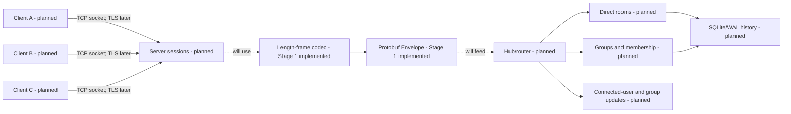

# Architecture and protocol

## Current checkpoint

This repository is at **Stage 1**. It defines the Protocol Buffers wire schema
and a standalone length-prefixed frame codec with tests. It does not yet
contain a working chat server, networked client, TLS,
rooms, persistence, GUI, or AI feature. Later-stage behavior below is a design
target, not a claim about the current executable.

The assignment requires separate client and server programs using socket
programming, at least two clients on different physical computers, unique
connected names, visible user and group lists, separate direct and group chat
rooms, self-join groups, and private delivery. A demonstration and
implementation-explanation slides will be needed to establish those
requirements; Stage 1 alone satisfies none of the end-to-end chat behaviors.
The [requirements checklist](requirements.md) maps each graded item to future
implementation and demonstration evidence.

## Intended runtime architecture



The dashed links mark integration work that has not been implemented. The
Stage 1 codec and schema are built and tested in process; no client/server path
in this diagram runs yet.

Each client talks only to the server. The server is authoritative for session
identity, connected users, direct rooms, groups, membership, message routing,
and room sequence numbers. A future headless client library will hide sockets,
framing, Protobuf, reconnection, and eventually TLS from a GUI. The CLI client
will exercise that library before a GUI exists.

The planned server-client chat path uses socket programming through Boost.Asio.
Its stack and rationale are:

| Layer | Why it is used | How it is used | Availability |
| --- | --- | --- | --- |
| Application protocol / Protobuf | Typed, compact messages with generated C++ APIs. | `proto/chat.proto` defines the `Envelope` and payloads. | Schema and serialization tests in Stage 1 |
| Length framing | TCP has no application-message boundary. | Four-byte big-endian size before each serialized envelope. | Codec and tests in Stage 1 |
| TCP | Ordered, reliable byte delivery while connected. | One persistent socket from each client to the server. | Planned for Stage 2 |
| TLS 1.3 | Confidentiality, integrity, and server authentication. | Layered on the TCP socket with certificate validation. | Planned for Stage 12 |
| IP | Addressing and routing among computers. | Clients connect to the server's IP address and TCP port. | Exercised once Stage 2 runs over a network |
| Wi-Fi / Ethernet | Physical/local network connectivity. | Carries IP traffic between demonstration computers. | Physical demo planned |

TLS is planned after plaintext TCP works; Stage 1 does not encrypt traffic.

The code boundaries are intended to stay clear as the project grows:

| Location | Responsibility | State |
| --- | --- | --- |
| `proto/chat.proto` | Typed v1 application messages. | Stage 1 |
| `include/chat/protocol/framing.hpp`, `src/protocol/framing.cpp` | Bounded byte framing without socket or Protobuf dependencies. | Stage 1 |
| `apps/server/`, `include/chat/server/`, `src/server/` | Server entry point, sessions, hub/router, and policy. | Planned |
| `apps/cli/`, `include/chat/client/`, `src/client/` | CLI entry point and reusable client networking API. | Planned |
| `tests/unit/`, `tests/integration/` | Component and networked behavior tests. | Unit tests present; integration planned |

## Wire format

One frame is exactly:

```text
4-byte unsigned payload length (network/big-endian byte order)
N serialized bytes of chat.protocol.Envelope
```

`N` must be between 1 and 1,048,576 bytes (1 MiB), inclusive. A zero or
oversized declared length is invalid. TCP supplies a byte stream, so a read
may contain part of a header, part of a payload, one frame, or several frames.
The decoder buffers partial input, emits each complete frame in order, and
rejects an unfinished frame when the connection ends. The frame codec is
independent of sockets and Protobuf; the caller parses an emitted payload as
`Envelope` and validates its contents. Frame acceptance alone does not mean a
valid chat operation.

`Envelope.protocol_version` is 1 for this schema. `Envelope.request_id` is a
client-chosen operation identifier: a direct response echoes it, while a
server-initiated update may leave it blank. A receiver must reject missing or
unsupported versions, missing oneof payloads, malformed serialized messages,
and invalid payload fields. These semantic checks belong above the frame codec
and are not implemented at Stage 1. Unknown future fields can be ignored by
Protobuf, but a future incompatible version must be rejected explicitly.

### Message direction and meaning

| Payload | Direction | Meaning |
| --- | --- | --- |
| `LoginRequest` | client to server | Claim a username for this connection. |
| `LoginResponse` | server to client | Accept or reject that claim with an explanation. |
| `DirectMessage` | both | Send text to a named user; server delivers to the participants. |
| `CreateGroupRequest` | client to server | Create a group whose only initial member is the creator. |
| `JoinGroupRequest` | client to server | The requesting user joins by opaque `group_id`. |
| `GroupMessage` | both | Send text to a group; server delivers only to members. |
| `UserListUpdate` | server to client | Complete connected-user snapshot, including this client. |
| `GroupListUpdate` | server to client | Complete group and membership snapshot. |
| `Ping` / `Pong` | both | Echo a nonce to check connection liveness. |
| `Ack` | server to client | A request succeeded; carries assigned resource/message data when applicable. |
| `Error` | server to client | A request failed; carries a machine-readable code and explanation. |

For client-submitted `DirectMessage`, only `recipient` and `text` are meaningful;
`sender`, `room_id`, `message_id`, sequence, and server timestamp must be
empty/zero. For client-submitted `GroupMessage`, only `group_id` and `text` are
meaningful. The server derives the sender from the registered connection,
checks the target and membership, and fills delivery metadata. It must never
authorize a request based on client-supplied sender or room metadata.

Group IDs and direct room IDs are server-assigned opaque values. Group display
names are separate from IDs, so a client joins the selected `group_id` rather
than relying on the displayed name. A successful create request returns its new
group ID in `Ack.resource_id`. Accepted messages can return `message_id` and
`room_sequence` in `Ack`; the server also includes these fields in deliveries.
The exact ID generation and retry policy are future work.

### Planned flows

1. A client connects, sends `LoginRequest`, and receives `LoginResponse`.
   Duplicate active usernames are rejected by the server.
2. After login, the server sends connected-user and group snapshots. It sends
   replacements whenever those sets change.
3. A direct-message request is routed into one room for the user pair. Only
   the sender and recipient receive that room's messages.
4. A create-group request adds only its creator. Another user may join only by
   issuing their own `JoinGroupRequest`; the server checks membership before
   routing group messages.
5. The server acknowledges accepted operations or returns `Error` with the
   matching `request_id`.

These are intended flows. Their handlers and privacy enforcement are not part
of Stage 1.

## Concurrency and ownership plan

The future Boost.Asio server will accept multiple TCP connections. Each
`ClientSession` will own one socket and serialize its outgoing writes through
one ordered queue. Async operations must keep the session alive until they
finish or are cancelled. A central hub/router will coordinate users, sessions,
groups, rooms, and membership; sessions will submit events instead of mutating
shared state independently. This keeps authorization and disconnect cleanup in
one place. The exact executor/strand and database worker design will be chosen
and documented when those stages are implemented.

## Reliability and security plan

Stage 1 provides bounded framing and serialization primitives only. TCP will
later provide ordered, reliable bytes while a connection remains healthy. A
future stage may assign message IDs and monotonically increasing room sequence
numbers, acknowledge accepted messages, persist history in SQLite/WAL, and
resume from the last received sequence after reconnect. The present schema
leaves room for history/sync payloads (oneof tags 30 and above). Exactly-once
delivery is **not** promised; the eventual retry and deduplication rules must
be specified before a reliability claim is made.

Future limits will cover username, group name, text, pending write queue, and
heartbeat timeout in addition to the current 1 MiB frame bound. Group
membership and direct-message privacy must be enforced on the server. Planned
login means selecting a unique connected name, not proving a real-world
identity. TLS 1.3 and certificate validation are planned for Stage 12. Until
then, any future plaintext TCP demo should be used on a trusted network only.
Certificate handling is described in the root
[certificate notes](../certs/README.md).

## Delivery sequence

The [implementation plan](plan.md) records stages and exit criteria. The
[progress tracker](progress.md) records verified completion separately from
this architecture proposal. Later, a GUI must provide a message display and
text input for each direct and group room, and the project must demonstrate an
AI feature to earn the assignment's special-feature points. Neither is a Stage
1 deliverable.
