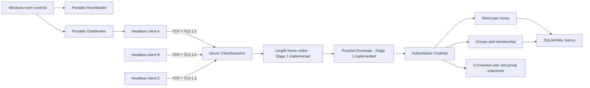

# Architecture and protocol

## Current checkpoint

This repository implements **Stages 0-13**: framed TCP, bounded sessions,
server-validated login, private direct rooms, self-join groups, member-only
routing, and user/group snapshots. The headless `ChatClient` supports chat
operations and typed events; `chat_cli` provides persistent chat and Ping/login diagnostics.
The Stage 14 Windows GUI now uses a portable `RoomModel` and `ChatWorker`.
SQLite/WAL history and message IDs/sequences/retry deduplication are implemented
through the headless API. The worker now provides bounded identity resume and
ordered sequence catch-up, retaining GUI drafts/transcripts. Verified TLS 1.3, Stage 15 AI/MCP agent tools, and on-demand history loading are implemented. Automated acceptance and pending manual checks
are recorded separately in [progress](progress.md).

The assignment requires separate client and server programs using socket
programming, at least two clients on different physical computers, unique
connected names, visible user and group lists, separate direct and group chat
rooms, self-join groups, and private delivery. A demonstration and
implementation-explanation slides will be needed to establish those
requirements; the current implementation provides headless chat and Windows room controls.
The [requirements checklist](requirements.md) maps each graded item to future
implementation and demonstration evidence.

## Intended runtime architecture

The separate [interactive onboarding](onboarding.md) application explains these
boundaries using deterministic browser simulations and hashed source snapshots.
It does not participate in the live chat path or change the C++ contracts.



Solid links are implemented and tested over loopback sockets. SQLite storage
is enabled by the server program; the embedded server API can also run without it.
No physical-computer acceptance has been recorded.

Each client talks only to the server. The server is authoritative for session
identity, connected users, direct rooms, groups, membership, message routing,
and room sequence numbers. The current headless client library hides
sockets, framing, Protobuf, and verified TLS from the GUI; recovery is implemented.

The planned server-client chat path uses socket programming through Boost.Asio.
Its stack and rationale are:

| Layer | Why it is used | How it is used | Availability |
| --- | --- | --- | --- |
| Application protocol / Protobuf | Typed, compact messages with generated C++ APIs. | `proto/chat.proto` defines the `Envelope` and payloads. | Schema and serialization tests in Stage 1 |
| Length framing | TCP has no application-message boundary. | Four-byte big-endian size before each serialized envelope. | Codec and tests in Stage 1 |
| TCP | Ordered, reliable byte delivery while connected. | One persistent socket from each client to the server. | Stage 2 Ping/Pong implemented |
| TLS 1.3 | Confidentiality, integrity, and server authentication. | Layered on the TCP socket with certificate validation. | Stage 12 implemented |
| IP | Addressing and routing among computers. | Clients connect to the server's IP address and TCP port. | Loopback tested; LAN smoke test pending |
| Wi-Fi / Ethernet | Physical/local network connectivity. | Carries IP traffic between demonstration computers. | Physical demo planned |

Executables require `--tls` credentials/trust or explicit `--plaintext-dev`.
Development plaintext is restricted to loopback. The [TLS guide](tls.md) records
certificate setup, SAN validation, handshake deadlines, and cancellation.

The code boundaries are intended to stay clear as the project grows:

| Location | Responsibility | State |
| --- | --- | --- |
| `proto/chat.proto` | Typed v1 application messages. | Stage 1 |
| `include/chat/protocol/framing.hpp`, `src/protocol/framing.cpp` | Bounded byte framing without socket or Protobuf dependencies. | Stage 1 |
| `apps/server/`, `include/chat/server/`, `src/server/` | Server entry point, reusable `ClientSession`, and authoritative `ChatHub`. | Routing, membership, and snapshots implemented |
| `apps/cli/`, `include/chat/client/`, `src/client/` | Diagnostic CLI and GUI-independent `ChatClient` operations/events. | Chat/events, recovery, TLS, and persistent CLI implemented |
| `apps/gui/` | Windows controls and separate client entry point; uses portable model/worker. | Automated native-control flows; manual acceptance pending |
| `tests/unit/`, `tests/integration/` | Component and networked behavior tests. | Unit and TCP integration tests present |

## Transport and login contract

The server accepts well-formed v1 `Envelope` requests. A `Ping` receives a
v1 `Pong`, echoing both the nonce and `request_id` exactly, before or after login.
All uint64 nonce values, including zero, are valid; an empty request ID is
allowed. A malformed frame or Protobuf message, missing/unsupported version,
missing payload, or a server-only payload closes that connection without a
response. Other clients continue normally. EOF closes a session; unfinished
frames are rejected by `FrameDecoder::finish()`. A complete request followed
by a send-side half-close still receives its response before EOF.

`PingServer` retains its Stage 2 API name and binds in its constructor (port
zero selects an ephemeral port). The caller owns and runs the `io_context`,
which may have multiple worker threads. `start()` and `stop()` dispatch onto
one shared hub strand. That strand owns the listener, connection registry,
active username registry, rooms, groups, and every session's read/write callbacks. `stop()`
is idempotent and closes the listener and clients. Drain cancellation handlers
before destroying the context. Accept handlers hold the implementation alive;
read/write handlers hold their session alive. Hub callbacks use weak server
references, so there is no ownership cycle. Disconnect callbacks post hub
cleanup onto this strand, preventing reentrant registry mutation when send
overflow closes a session during routing or snapshot broadcast.

The server accepts up to 64 active connections. Additional accepted sockets
close immediately. Each connection uses a 4 KiB read buffer and the existing
decoder's 1 MiB frame bound. `ClientSession` admits at most 256 queued frames
and 2 MiB of framed bytes by default, counting the active write. A mutex
orders admission and enforces limits before posting executor work, so concurrent
producers cannot bypass the bound by filling the executor with payload captures.
Only one pump is scheduled and one composed write runs per socket; reads may
run concurrently with that write. Sequential sends keep their order; racing
producers are ordered by admission, preserving each producer's sequence.
Admission success does not promise delivery. Overflow or an invalid outgoing
frame closes the session and discards its pending queue. Wire-buffer bounds
exclude parsed messages and temporary serialization allocations.

`start`, `send`, and `stop` are safe to call from different threads while the
session and context are alive. Closing admission is immediate; socket close
and the single disconnect callback run on the strand. The active write handler
owns its buffer separately, keeping it alive when stop clears the queue.
Clean read EOF disables new sends and drains admitted replies before closing;
truncated EOF, reset, protocol error, overflow, and server stop cancel immediately.
Each session also owns one steady-clock timer, bound to its executor and held
alive by its pending handler. After 30 seconds without a complete valid inbound
request, it closes through this same cleanup path. Only parsed client-request
envelopes refresh activity; partial bytes and outgoing traffic do not. Expiry
applies before login too. Stop cancels the timer; draining the context releases
its handler ownership. Zero disables expiry; configured budgets may not exceed
24 hours. Clean EOF can drain replies only until expiry. The
[heartbeat guide](heartbeats.md) explains configuration and headless use.

Login accepts a case-sensitive username of 1-32 ASCII letters, digits, or
underscores. No trimming, Unicode normalization, or case folding is performed.
The hub reserves an unused name atomically on its strand, binds it to the
connection, and replies with an accepted `LoginResponse` containing that name.
Invalid or duplicate names receive a rejected response with a nonempty reason
and no username. Rejected clients may try a different name on the same socket.
A logged-in connection cannot rename itself or log in again. Disconnect removes
its name, including cancellation and protocol-failure paths. Login selects an
active display name; it does not authenticate a real-world identity.

Direct/group messages and create/join requests require login and otherwise
receive a correlated `NOT_LOGGED_IN` error. Client-supplied sender metadata
never grants privileges. Implemented routing rules follow below.

`ChatClient` is a source-compatible alias of the extended `PingClient`. It owns
its networking loop/socket and exposes blocking `connect`, `ping`, `login`,
`send_direct`, `create_group`, `join_group`, `send_group`, `next_event`, and
`close`, with one caller at a time. Use it on a
worker thread when integrating into a GUI. DNS resolution/connect and each
whole write/read exchange have configurable deadlines, defaulting to three
seconds. Timeout cancels resolution and closes the socket; socket/protocol
errors also close it and throw `std::runtime_error`. Nonpositive deadlines
throw `std::invalid_argument`. Each call drains its callbacks before returning,
so handler references to local buffers remain valid. Responses must have
the generated request ID and expected payload. Reads may contain several
events/responses or a reply followed by a partial event; the decoder preserves
that partial input across calls rather than assuming a TCP read boundary.
Pong nonces and accepted login usernames must match the request. `login` returns
a GUI-independent `LoginResult`; a rejected name leaves the connection open.
The client buffers unsolicited events while waiting for a response and exposes
GUI-independent delivery/snapshot structs through `ClientEvent`. The event queue
is bounded to 256 frames and 2 MiB of framed bytes; overflow closes the connection
instead of silently losing chat. `next_event` reads on demand, without a background
network thread. A quiet receive deadline cancels that read, returns `nullopt`,
and preserves the connection and partial decoder input. Connection/operation
deadlines still close on timeout. Callers must consume events regularly.
The CLI retains the one-shot login/Ping form and adds `chat host port username`.
It uses the same worker for core flows, typed events, heartbeats, identity resume,
and bounded replay. Unknown worker command enum values fail admission.
See the [CLI guide](cli.md) for syntax, receipts, and API usage.

The CLI presentation thread polls stdin and worker updates without a blocking
input thread. Input chunks are at most 1,024 bytes; partial lines are bounded
to 8,192 bytes, discarding overflow through the next delimiter. It retains latest
user/group snapshots and at most 64 pending receipt IDs, without a transcript.
Output escapes remote ASCII controls and delimiters; tokens/keys are never printed.
Server authorization governs all sends and joins. Quit/EOF drains admitted receipts
for at most five seconds, then stops the worker; its active three-second operation
deadline bounds the join. Interrupt requests immediate stop. Terminal failure
can exit even while stdin is open and idle. Slow output can trigger the existing
bounded worker update-overflow failure.

## GUI model and worker ownership

`Window` owns the controls, `RoomModel`, and `ChatWorker`. Only the UI thread
touches controls/model. One `std::jthread` owns a `ChatClient` and every socket
operation; UI commands and polling transfer plain values under a mutex. Connect,
login, create, self-join, and sends run on that worker. There are at most 64
queued commands plus one active command, and 256 queued updates with a 2 MiB
budget counting structures and string lengths. Commands admit at most 64 target
bytes and 4,096 text bytes; the UI separately bounds 64 pending correlations.
Update overflow closes the connection and latches a separate terminal reason,
so stopping event consumption produces an explicit failure.

Disconnect requests stop immediately; the owning worker closes its socket after
the current operation (default three-second deadline) or event poll (25 ms).
Destruction joins that thread before destroying its state. The worker publishes
ended state before polling can see the terminal update. A new explicit Connect
joins the ended worker and starts a fresh login. Durable transport loss instead
triggers bounded identity resume and sequence replay within the running worker;
see [recovery](recovery.md).

The model routes deliveries by server room ID. A provisional direct view binds
to its first server ID; a disconnected/reclaimed peer gets a new view. Group
display names can repeat without mixing rooms. Complete snapshots drive users,
members, and send/join availability. Server authorization remains authoritative
even if a client bypasses disabled controls. ACKs clear only a matching submitted
draft, while server echoes populate transcripts, avoiding optimistic duplicate
lines and preserving text typed during a pending send.

Local retention is capped at 256 views, 100 lines per view, and 2 MiB of
sender/text/receipt strings. Globally oldest lines are discarded at the byte cap. Old direct views
are evicted first at the view cap, preserving the server's at most 128 discovered
groups. Each draft is bounded to 16,384 UTF-8 bytes (the edit control admits 4,096
UTF-16 units); send admission still enforces 4,096 UTF-8 bytes. Disconnect keeps
local transcripts/drafts offline; a successful new login clears them. These
budgets exclude allocator overhead and temporary display strings. Nothing is
saved to disk or requested from the server as history. The native GUI target and
control tests build only on Windows; model/worker targets remain portable C++.

## Direct rooms, groups, and snapshots

New direct messages require a connected recipient and 1-4,096 bytes of text;
accepted retries can recover their receipt while the original recipient is offline.
All client-supplied sender, room, server message-ID, sequence, and timestamp fields
must be empty/zero; forged values return `INVALID_REQUEST`. An absent recipient
returns `USER_NOT_FOUND`. The hub derives sender identity from its connection
registry and assigns one opaque `direct-N` room ID per active connection pair,
shared in both directions. Only the sender and recipient receive the delivery.
Self-messages produce one echo. Disconnect removes that connection's rooms;
reclaiming its username creates a new room, with no inherited history.

Group names contain 1-64 UTF-8 bytes, must not be all ASCII spaces, and cannot
contain ASCII control characters. Display names may repeat: distinct opaque
`group-N` IDs identify distinct rooms. At most 128 groups exist per database,
or per run in ephemeral mode.
Creation adds only the requesting connection. A `JoinGroupRequest` adds only
its requesting connection; duplicate joins return `ALREADY_MEMBER`, and unknown
IDs return `GROUP_NOT_FOUND`. Group text uses the same 1-4,096 byte bound and
rejects forged sender/message metadata. Only an actual member may send, and
only members receive the delivery, including one sender echo. Nonmembers
receive `NOT_GROUP_MEMBER` and cause no delivery.

Membership belongs to the active connection. Disconnect removes it from every
group. Empty groups remain visible and joinable, including across restart when
storage is enabled. A new connection
claiming the same display name must explicitly rejoin. Resource IDs and all
rooms/groups are scoped to the persistent database when enabled, or to the
server run in ephemeral mode. Durable direct participation is described below.

Every successful operation returns an `Ack` with the original request ID:
`resource_id` is the direct room or group ID. It acknowledges validation and
the operation/routing attempt after a successful commit when storage is enabled;
ephemeral mode acknowledges in-memory acceptance. It does not promise recipient
receipt. Deliveries and snapshots have empty request IDs. Message deliveries carry server IDs, positive room sequences, and timestamps.
Saved-key retries return the original receipt without another fanout.

Successful login sends user and group snapshots to all registered connections,
after the new client's login response. Group create/join broadcasts complete
group/member replacements, after its operation ACK. Disconnect broadcasts the
new user list and, if membership changed, the new group list. Snapshots contain
only active registered names; every recipient sees itself and all groups,
including groups it has not joined. Names/members are sorted lexically and
groups are sorted by ID. Unregistered and rejected-login connections receive
no snapshots. Slow receivers may be disconnected by the bounded write queue;
the subsequent cleanup broadcasts a consistent replacement snapshot.

## Transactional history and durable identities

The server program opens `data/chat.sqlite3` by default; its optional third
argument selects a database path. Embedded `PingServer` accepts an optional
database path; an empty path retains the earlier ephemeral behavior. Startup
fails before listening if storage cannot be opened or its schema is unsupported.
`HistoryStore` enables foreign keys, WAL for files, `synchronous=FULL`, and a
100 ms busy timeout. Schema version 2 stores participant identities, rooms,
group admissions, immutable messages indexed by `(room,id)`, server metadata,
and sender-scoped retry keys. Existing v1 databases upgrade atomically before
listening: cursors/text remain intact, room sequences follow old cursor order,
and old timestamps are zero. SQL statements
bind input values. Storage errors return generic errors without paths, SQL,
message content, or tokens.

Each fresh persistent login receives a new durable principal and a random
256-bit resume token, with only its SHA-256 hash stored. A fresh claim of an old
username gets a different principal and no access to that principal's direct
history. `resume_login` must prove the original token and matching username;
active name uniqueness still applies. Tokens are bearer secrets, not passwords
or proof of a real-world person. TLS 1.3 protects network traffic; explicit plaintext development is loopback only.
The GUI and persistent CLI workers retain the capability in memory for automatic
recovery and replay; process restart saves no capability or cursor.

Persistent direct rooms identify durable principal pairs. Resuming both original
participants reuses their room ID; either can explicitly read it while the other
is offline. A name-only replacement cannot read it. Persistent group IDs/names
survive restart, but active membership is empty then. Current connections must
explicitly join again, including a resumed creator. Current group members may
read the room's full history, including messages before their join. Historical
admissions are audit data and never grant live delivery or history access alone.

Direct room creation, message/key insertion, and room sequence advancement commit
in one transaction. Group messages also commit their key and counter together. Group
creation and creator admission commit together. Other writes are single-statement
transactions. No message ACK or delivery is queued before the successful commit.
Lock, insert, and read errors fail the operation; failed joins/logins do not
publish membership or reserve names. ACKs still do not promise recipient receipt,
automatic replay or recipient display. Message ACKs now include stable server IDs
and room sequences; accepted saved-key retries return the same receipt without
redelivery. See [message reliability](reliability.md) for the policy and limits.

History requests require login and a server authorization check. A response has
at most 100 ascending records (default 50), bounded text fields, a next cursor,
and `has_more`. The cursor is the database's global message row ID, not a
per-room wire sequence. A missing/unrelated room and group nonmembership return
`HISTORY_FORBIDDEN` without content. Pages are explicit responses, separate from
unsolicited events; the headless client validates bounds, room, ordering, and
cursor while retaining interleaved/partial events. Stage 11 adds a separate
per-room sequence sync API and automatic worker catch-up.

The store connection belongs to the hub strand after construction; synchronous
SQLite operations preserve authorization/order without a second work queue.
The busy timeout bounds lock waits, but filesystem flush latency is not bounded
by that timeout. Storage may delay other hub work; an asynchronous storage
executor is a later optimization. Database disk growth is not capped. The
[history guide](history.md) describes operating and backing up the store.

## Wire format

One frame is exactly:

```text
4-byte unsigned payload length (network/big-endian byte order)
N serialized bytes of chat.protocol.Envelope
```

`N` must be between 1 and 1,048,576 bytes (1 MiB), inclusive. A zero or
oversized declared length is invalid. TCP supplies a byte stream, so a read
may contain part of a header, part of a payload, one frame, or several frames.
The decoder buffers partial input, emits each complete frame in order, and
rejects an unfinished frame when the connection ends. The frame codec is
independent of sockets and Protobuf; the caller parses an emitted payload as
`Envelope` and validates its contents. Frame acceptance alone does not mean a
valid chat operation.

`Envelope.protocol_version` is 1 for this schema. `Envelope.request_id` is a
client-chosen operation identifier: a direct response echoes it, while a
server-initiated update may leave it blank. A receiver must reject missing or
unsupported versions, missing oneof payloads, malformed serialized messages,
and invalid payload fields. These semantic checks belong above the frame codec
and are implemented for Ping/Pong, login, and chat operations. Unknown future fields can be ignored by
Protobuf, but a future incompatible version must be rejected explicitly.

### Message direction and meaning

| Payload | Direction | Meaning |
| --- | --- | --- |
| `LoginRequest` | client to server | Claim a username for this connection. |
| `LoginResponse` | server to client | Accept or reject that claim with an explanation. |
| `DirectMessage` | both | Send text to a named user; server delivers to the participants. |
| `CreateGroupRequest` | client to server | Create a group whose only initial member is the creator. |
| `JoinGroupRequest` | client to server | The requesting user joins by opaque `group_id`. |
| `GroupMessage` | both | Send text to a group; server delivers only to members. |
| `UserListUpdate` | server to client | Complete connected-user snapshot, including this client. |
| `GroupListUpdate` | server to client | Complete group and membership snapshot. |
| `Ping` / `Pong` | both | Echo a nonce to check connection liveness. |
| `Ack` | server to client | A request succeeded; carries assigned resource/message data when applicable. |
| `Error` | server to client | A request failed; carries a machine-readable code and explanation. |
| `HistoryRequest` / `HistoryResponse` | request/response | Authorized, bounded ascending stored-room page with a database cursor. |

For client-submitted `DirectMessage`, `recipient`, `text`, and an optional
`client_message_id` retry key are meaningful;
`sender`, `room_id`, `message_id`, sequence, and server timestamp must be
empty/zero. For client-submitted `GroupMessage`, `group_id`, `text`, and the optional
retry key are meaningful. The server derives the sender from the registered connection,
checks the target and membership, and fills delivery metadata. It must never
authorize a request based on client-supplied sender or room metadata.

Group IDs and direct room IDs are server-assigned opaque values. Group display
names are separate from IDs, so a client joins the selected `group_id` rather
than relying on the displayed name. A successful create request returns its new
group ID in `Ack.resource_id`. Message ACKs and deliveries contain server-owned
`message_id` and `room_sequence`; deliveries/history also carry timestamps.
Resource IDs use durable SQLite room row IDs when enabled, otherwise per-run
counters. Request IDs correlate exchanges; separate sender-scoped message keys
deduplicate accepted text. Durable keys/receipts live with their stored row;
ephemeral connections keep a FIFO window of 256 accepted keyed messages. Keys
are not sent in deliveries/history. Conflicting type/target/text is rejected.

### Implemented headless flows

1. A client connects, sends `LoginRequest`, and receives `LoginResponse`.
   Duplicate active usernames are rejected by the server.
2. After login, the server sends connected-user and group snapshots. It sends
   replacements whenever those sets change.
3. A direct-message request is routed into one room for the user pair. Only
   the sender and recipient receive that room's messages.
4. A create-group request adds only its creator. Another user may join only by
   issuing their own `JoinGroupRequest`; the server checks membership before
   routing group messages.
5. The server acknowledges accepted operations or returns `Error` with the
   matching `request_id`.

These flows have automated headless/socket and Windows control coverage. Live
physical-computer demonstrations remain pending.

## Concurrency and ownership

The shared hub strand described above serializes registry changes and session
events even with multiple networking workers. Room/group routing uses
this same executor boundary; sessions submit decoded envelopes to the hub
instead of deriving identity or mutating registry state. Persistence currently runs synchronously on the hub strand. Client networking is
owned by the headless API or its bounded worker; both GUI and CLI use plain values.

## Reliability and security plan

The current transport provides bounded framing and ordered TCP bytes while a
connection remains healthy. Stage 10 provides stable IDs, per-room sequence
numbers, and explicit saved-key retries. It commits before ACK/routing and
returns accepted duplicates without fanout. Direct retries stay pinned to the
original recipient principal; group retries require current membership. Failed
transactions reserve neither sequence nor key. The worker includes ID/key
strings in bounded update accounting. Stage 11 retains pending message keys
across transport loss, retries after durable resume/self-rejoin, and suppresses
already applied room sequences. Manual reconnect remains a fresh login. The
schema uses history tags 30-31, sync tags 32-33, and private directory tags 34-35. Exactly-once
delivery is **not** promised. [Message reliability](reliability.md) defines the
retention window, schema migration, client validation, and receipt semantics.

Current limits cover usernames, group names/count, text, pending writes/events,
connections, frame size, and stale-session timeouts. The GUI worker sends
correlated Ping/Pong heartbeats every 10 seconds with its three-second operation
deadline. Transport failures recover under a durable identity within the bounded
retry budget; malformed responses or exhausted recovery publish a terminal error. It checks
the clock before queued commands and caps event polls, so continuous traffic
does not starve heartbeats. Replies remain internal; socket ownership and ordered
writes remain on the worker. Stop starts no further operation after the active
one finishes. Custom server deadlines require an appropriate client cadence;
the blocking headless API leaves heartbeat scheduling to its caller. Synchronous
storage can delay the shared executor and its timer callbacks. Group
membership and direct-message privacy must be enforced on the server. Current
login selects a unique connected name without proving a real-world
identity. TLS 1.3 authenticates the server through an explicit CA and DNS/IP
SAN before any application exchange. No failure falls back to plaintext.
Certificate handling is described in the [TLS guide](tls.md).

TLS wraps the existing socket owner and bounded ordered writer. Each server
handshake shares the hub strand, has its own deadline, and occupies a connection
slot. Application reads/writes start after negotiation. Client connect's deadline
covers resolution, TCP connection, and TLS. Contexts and buffers outlive pending
handlers; stop cancels timers and closes the lowest socket. TLS close is abortive,
without a competing shutdown writer or an unbounded `close_notify` wait.
Certificate/protocol errors are terminal `TlsError`; transport interruption
remains recoverable `NetworkError`. Reconnect revalidates the same trust/name
configuration and never switches identity or transport mode.

## Delivery sequence

Stage 11 separates retryable transport failures (`NetworkError`) from malformed
protocol failures. A storage-enabled worker retains its capability, command keys,
chosen groups, and up to 256 room cursors for its current run. Recovery uses
stop-aware exponential backoff, identity resume, explicit self-rejoin, and
principal-scoped direct discovery. It captures a room watermark and applies
contiguous sync records before publishing later live sequences. Cursors advance
only after update admission; already applied sequences are suppressed in the
worker and model. Protocol/auth/gap/queue failures remain terminal. Login/join
snapshots precede group replay. A server-authored original-peer availability
flag binds recovered direct rooms without trusting display names. No token,
pending attempt, or cursor is saved across client process restart.

The GUI keeps drafts, transcripts, pending correlations, and the selected room
during temporary offline status. Resumed completion does not reset its model.
Default recovery permits 16 attempts at 250 ms doubling to 2.5 seconds, with a
three-second deadline per network operation. Queue and room bounds still end
explicitly. Unknown group creation is not retried; uncertain join retains the
user's join intent. [Recovery](recovery.md) specifies tags 32-35, privacy,
retry completion, cancellation, and display-retention limits.

The [implementation plan](plan.md) records stages and exit criteria. The
[progress tracker](progress.md) records verified completion separately from
this architecture proposal. The Windows GUI provides each room's display and
draft/send controls; manual acceptance remains pending. Stage 15 implements `chat::ai::AiEngine` (TextRank + VADER) and `chat::ai::McpDispatcher` / `LoopbackAgentServer` (`include/chat/ai/`, `src/ai/`) for Special Points 1 and 2; see [AI & MCP Agent](ai.md).
